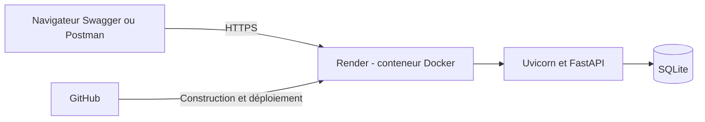

# Gestion des stages - Groupe 1

Mini-projet Cloud Computing, Microservices et API, FIE5, ISIS.

**Membres :** Mohamed Aziz BRAHAM, Ghofrane BOUALLEGUE, Dheker KRAIEM et Malek GABSI.

API REST développée avec **Python 3.12, FastAPI et SQLite**, conteneurisée avec Docker et préparée pour Render (plan gratuit).

## Liens

- Dépôt : https://github.com/mohamedazizbraham/mini-projet-groupe-1
- API publique : https://mini-projet-groupe-1.onrender.com
- Swagger public : https://mini-projet-groupe-1.onrender.com/docs
- Swagger local : http://localhost:8000/docs

## Démarrage avec Docker

Installer et démarrer Docker Desktop, puis ouvrir un terminal à la racine du projet :

```sh
docker compose up --build -d
docker compose ps
```

Ouvrir http://localhost:8000/docs. Le volume nommé `stages_data` conserve la base entre les redémarrages locaux.

```sh
docker compose logs api
docker compose down
```

Pour montrer séparément les étapes demandées dans l'énoncé :

```sh
docker build -t stages-api .
docker run --name stages-demo -d -p 127.0.0.1:8000:8000 stages-api
```

Arrêter d'abord le service Compose si le port 8000 est déjà occupé. Le lancement direct ci-dessus ne monte pas de volume : sa base disparaît lorsque le conteneur est supprimé.

## Démarrage sans Docker

Dans PowerShell, avec Python 3.12 installé :

```powershell
py -3.12 -m venv .venv
.\.venv\Scripts\python.exe -m pip install -r requirements-dev.txt
.\.venv\Scripts\python.exe -m uvicorn app.main:app --host 127.0.0.1 --port 8000
```

Sous Linux/macOS, utiliser `python3 -m venv .venv` puis `.venv/bin/python` à la place de `.\.venv\Scripts\python.exe`.

## Endpoints

| Méthode | Chemin | Rôle | Succès |
|---|---|---|---|
| GET | `/` | Informations du service | 200 |
| GET | `/health` | Disponibilité de l'API et de la base | 200 |
| POST | `/stages` | Créer un stage | 201 |
| GET | `/stages` | Lister les stages, triés par identifiant | 200 |
| GET | `/stages/{id}` | Consulter un stage | 200 |
| PUT | `/stages/{id}` | Remplacer toutes les informations d'un stage | 200 |
| DELETE | `/stages/{id}` | Supprimer un stage | 204, sans corps |

`GET /stages` accepte `offset` (défaut 0) et `limit` (défaut 100, maximum 1000). Une liste vide renvoie `[]`. Un identifiant inexistant renvoie 404 ; un corps invalide ou incomplet renvoie 422.

Exemple de corps pour POST ou PUT, avec des données entièrement fictives :

```json
{
  "nom_etudiant": "Camille Exemple",
  "entreprise": "Entreprise Demo",
  "intitule": "Developpement API Cloud",
  "date_debut": "2027-02-01",
  "date_fin": "2027-07-31"
}
```

L'identifiant est attribué par SQLite. Les textes vides sont refusés, les espaces extérieurs sont supprimés, les dates utilisent le format `AAAA-MM-JJ`, et la fin ne peut pas précéder le début. PUT attend les cinq champs ; il ne s'agit pas d'une mise à jour partielle.

## Tests

```powershell
.\.venv\Scripts\python.exe -m pytest -q
.\.venv\Scripts\python.exe scripts/smoke_test.py http://localhost:8000
```

Le premier test utilise une base temporaire distincte pour chaque scénario. Le second appelle une API réellement démarrée et ne supprime que le stage fictif qu'il crée. Pour Render, remplacer l'adresse locale par l'URL publique. Le workflow GitHub Actions lance les tests, construit l'image et vérifie le cycle CRUD dans un conteneur.

## Déploiement et démonstration

- [Guide Render](docs/DEPLOIEMENT.md)
- [Scénario Swagger et captures à fournir](docs/DEMONSTRATION.md)
- [Présentation technique et répartition proposée](docs/RAPPORT.md)
- [Dossier PDF avec les preuves de fonctionnement](docs/Dossier-mini-projet-groupe-1.pdf)
- [Résultats effectivement vérifiés](docs/VALIDATION.md)

Le service Render a été créé à partir de l'URL du dépôt public. Pour publier une modification, pousser le code sur GitHub puis choisir **Manual Deploy > Deploy latest commit** dans Render ; ne pas supposer qu'un push déclenche automatiquement un déploiement dans cette configuration.

## Architecture et limites



Un service suffit pour le domaine demandé. Le projet illustre une API métier déployable indépendamment, sans prétendre constituer une architecture distribuée à plusieurs microservices.

L'API pédagogique est ouverte, sans authentification : **utiliser uniquement des données fictives**. Toute personne connaissant l'URL peut consulter, créer, modifier ou supprimer les stages. Les requêtes SQL sont paramétrées et le conteneur tourne sans privilèges administrateur. Une utilisation réelle nécessiterait notamment authentification, autorisations et stockage persistant.

Sur Render gratuit, le stockage local est éphémère : une mise en veille, un redémarrage ou un redéploiement peut effacer SQLite. Le premier accès après une veille peut prendre du temps. Ces limites sont compatibles avec l'exercice pédagogique ; elles ne conviennent pas à une gestion réelle des stages.

Documentation officielle : [FastAPI](https://fastapi.tiangolo.com/), [Docker sur Render](https://render.com/docs/docker), [offre gratuite Render](https://render.com/docs/free).
